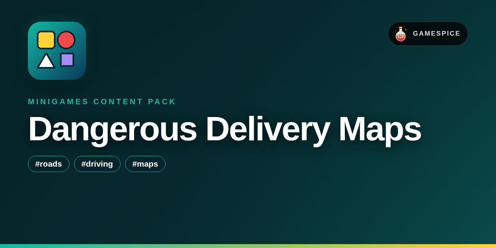

Mountain roads for [mg-dangerous-delivery](https://github.com/zees-games/mg-dangerous-delivery). Each mountain has one road, generated from a community map. Only the road's shape is used; no geometry, textures or models of the original are shipped.

## Using it

A server mounts the pack with `maps: add: gamemann/mg-dangerous-delivery-maps`. `routes/` holds each route (`dd_<map>.json`) and its map (`<map>.json`); the game sorts them by `kind`. `tools/publish.sh` publishes the pack.

The routes are made by `adapters/mg-dangerous-delivery/bsp_route.py` in gs-map-convert. The game's `headless_passable` test walks every road here.

## Quality and ongoing improvement

The models, textures, animations, sounds and maps in this pack are improved automatically and recursively by AI agents. [Nightly](https://github.com/gamemann/nightly) keeps a board of improvement items. Agents pick up an item, make the change, render fresh frames and check them with a visual judge. Judge findings become new items, and the loop repeats until the result is production quality. Improvements ship as new pack versions, and the screenshots in this README are re-shot each time. Some assets are still low quality today.

## Credits

| Map | Author | Source | Licence |
| --- | --- | --- | --- |
| `gm_fork` | Blueberry_pie | [Steam Workshop](https://steamcommunity.com/sharedfiles/filedetails/?id=326332456) | none stated |
| `gm_boreas` | Blueberry_pie | [Steam Workshop](https://steamcommunity.com/sharedfiles/filedetails/?id=1572373847) | none stated |
| `rp_southside` | Fishke | [Steam Workshop](https://steamcommunity.com/sharedfiles/filedetails/?id=2010286798) | none stated |

The authors are credited here, in [licence.json](licence.json) and in each document's `author` field.

If you made one of these maps and want it removed, open an issue at <https://github.com/zees-games/mg-dangerous-delivery-maps/issues> and it goes.

Everything else is MIT, see [LICENSE](LICENSE).
